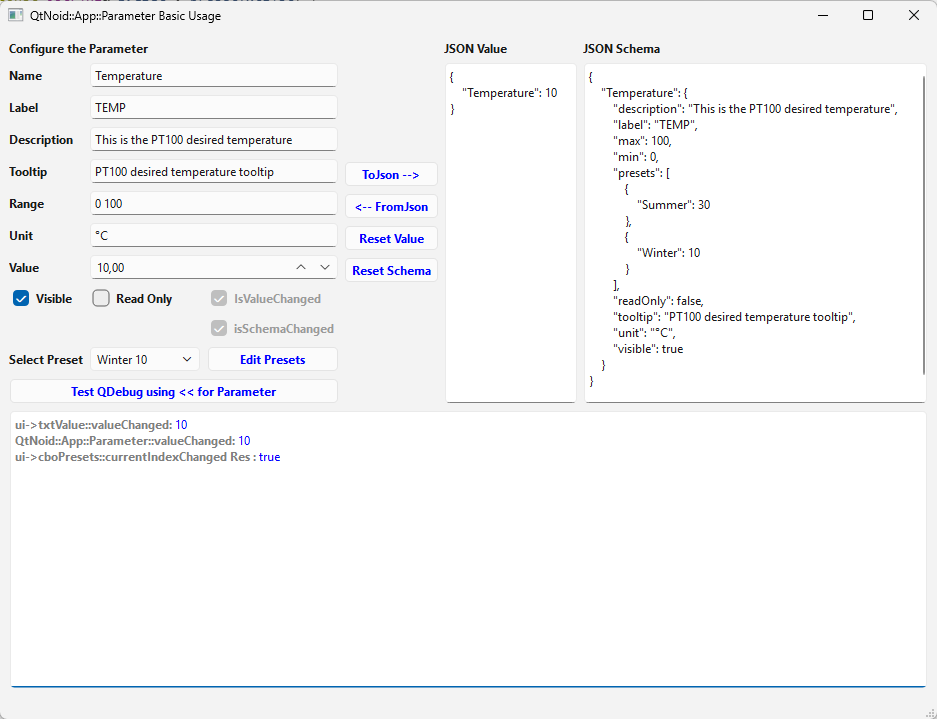
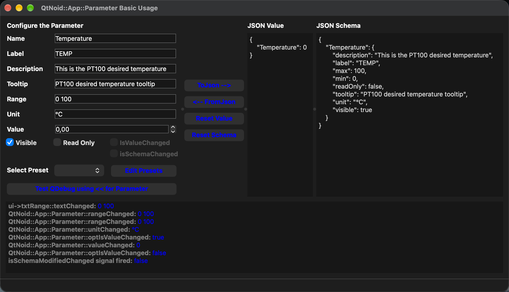

# QtNoid::App::Parameter Basic Usage
This is a simple Qt application that showcases how to use the `QtNoid::App::Parameter` class from `QtNoidApp`: creating a parameter, editing every one of its properties through the UI, and converting it to and from a JSON schema and a JSON value.

Every property (`name`, `label`, `description`, `tooltip`, `range`, `unit`, `value`, `readOnly`, `visible`) is bound both ways: editing a UI field updates the `Parameter`, and every signal the `Parameter` fires back - including `isValueModifiedChanged`, `isSchemaModifiedChanged` and `writeAttemptedWhileReadOnly` - is logged in the colored log at the bottom of the window and updates the corresponding UI field.

Presets can be applied from the combo box, or edited as plain text (one `name value` pair per line) through a dedicated dialog.

The two checkboxes mirror `isValueModified()` and `isSchemaModified()`, and the two buttons next to them call `resetValueModifications()` and `resetSchemaModifications()`.

The **To Json** / **From Json** buttons convert the parameter to and from its JSON schema and JSON value (via `toJsonSchema()`/`toJsonValue()` and `fromJson()`), shown as editable text in the two panels on the right - edit the JSON directly and click **From Json** to apply it back to the parameter.

## Windows 11

## macOS

⬆[Examples](../../Examples.md)

[← Back to README](../../../README.md)
